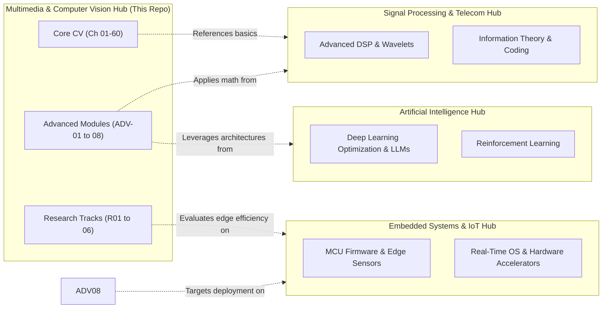

# ACADEMIC GAP ANALYSIS & COGNITIVE PROGRESSION
## Transitioning from Undergraduate Competency (L1/L2) to Graduate & Research Readiness (L3/L4)
**Document Version:** 1.0.0  
**Phase:** AD-05 Architecture Planning  
**Target Architecture:** Core (L1/L2) $\rightarrow$ Advanced Modules (L3) $\rightarrow$ Research Tracks (L4)

---

## 1. Context & Objective

The completed 60-chapter Core Curriculum of the **Multimedia & Computer Vision Learning Hub** establishes a comprehensive foundation for undergraduate students (specifically S1 Teknik Telekomunikasi at ITERA). It provides:
- Mathematical breadth across signals, 2D transforms, image filtering, and classical geometry.
- Foundational deep learning (MLP, CNN backbones, basic ViT, standard object detection, and basic optical flow).
- Web-first interactive laboratories and CPU/NumPy dual-engine standalone Python scripts.

However, preparing students and independent learners for **graduate-level research (Master's/PhD)**, high-impact scientific publications (CVPR, ICCV, ECCV, NeurIPS, IEEE TPAMI), and production-grade computer vision engineering requires bridging critical **academic, algorithmic, mathematical, and experimental gaps**.

This document systematically diagnoses those gaps, establishes strict boundary criteria to prevent redundant duplication, and formulates clean interfaces to neighboring engineering learning hubs.

---

## 2. Dimension-by-Dimension Gap Analysis

### 2.1 Mathematical Gaps (Theory & Analytical Rigor)

| Competency Area | Core Curriculum Level (L1 / L2) | Graduate & Research Requirement (L3 / L4) | Academic Gap & Curricular Remedy |
| :--- | :--- | :--- | :--- |
| **Matrix Calculus & Derivatives** | High-school / undergraduate scalar calculus; partial derivatives explained intuitively ($\frac{\partial L}{\partial w}$). | Tensor calculus, Jacobian and Hessian matrices, matrix trace calculus ($\nabla_W \text{Tr}(A W B)$), autograd computation graph mathematics. | **ADV-01 Topic 1:** Formalization of tensor derivatives, backpropagation mechanics through arbitrary matrix transformations, and derivation of gradient vanishing/exploding dynamics in deep networks. |
| **Optimization Theory** | Basic stochastic gradient descent (SGD), standard Adam heuristic, learning rate decay. | Constrained convex optimization, Lagrangian duality, KKT conditions, second-order methods (Gauss-Newton, Levenberg-Marquardt), non-convex saddle point dynamics. | **ADV-01 Topic 4 & ADV-05 Topic 4:** Rigorous treatment of non-linear least squares in bundle adjustment, structure-from-motion, and constrained loss formulation. |
| **Probability & Information Theory** | Basic probabilities, Gaussian distributions, mean and variance of image histograms. | Multivariate Gaussian distributions, covariance ellipsoids, Kullback-Leibler (KL) divergence, Jensen-Shannon divergence, InfoNCE contrastive mutual information lower bounds. | **ADV-01 Topic 3, ADV-03 Topic 2, ADV-07 Topic 1:** Rigorous Bayesian tracking formulations (Kalman/EKF/UKF) and contrastive representation learning bounds. |
| **Variational & Functional Calculus** | Discrete convolution kernels (Sobel, Laplacian, Gaussian blur filters). | Continuous energy minimization, Euler-Lagrange equations, Total Variation (TV) functional, inverse problem regularization, ADMM and Split Bregman solvers. | **ADV-02 Topic 2 & 3:** Mathematical inverse problem formulation ($y = A x + n$) for deblurring, super-resolution, and blind deconvolution. |
| **Projective & Differential Geometry** | Basic affine transforms, translation, rotation matrices, 2D homography matrix. | Projective space $\mathbb{P}^2, \mathbb{P}^3$, epipolar geometry (Fundamental & Essential matrices), Lie groups $\text{SO}(3), \text{SE}(3)$, and Lie algebra $\mathfrak{so}(3), \mathfrak{se}(3)$. | **ADV-01 Topic 5 & ADV-05 Topic 1–3:** Multi-view epipolar geometry, camera extrinsic parameter manifolds, and bundle adjustment. |

---

### 2.2 Algorithmic Gaps (Architecture & Formulations)

| Domain | Core Curriculum Level (L1 / L2) | Graduate & Research Requirement (L3 / L4) | Academic Gap & Curricular Remedy |
| :--- | :--- | :--- | :--- |
| **Object Detection** | Single-stage anchor-based (SSD / YOLOv3 conceptual), bounding box IoU, Non-Maximum Suppression (NMS). | Modern anchor-free detectors, deformable self-attention (DETR / Deformable DETR), Generalized Focal Loss, IoU variants (GIoU, DIoU, CIoU, SIoU). | **ADV-04 Topic 3 & 4:** Mathematical formulation of bipartite matching loss, Hungarian loss optimization in transformer detectors, and IoU metric loss dynamics. |
| **Visual Tracking & MOT** | Single-object tracking (KCF / Lucas-Kanade), centroid tracking, basic SORT with simple Kalman filter. | DeepSORT with cosine appearance metric embeddings, ByteTrack association under low-confidence detections, BoT-SORT camera motion compensation, occlusion recovery. | **ADV-03 Topic 1–4:** State-of-the-art MOT data association algorithms, global link graph optimization, and appearance-motion fusion. |
| **Vision Foundation Models** | Loading pretrained CLIP and basic ViT feature extraction. | Contrastive visual pretraining from scratch (SimCLR, MoCo, InfoNCE), Masked Autoencoders (MAE), Parameter-Efficient Fine-Tuning (LoRA, Adapter layers), Vision-Language token routing. | **ADV-07 Topic 1–4:** Mathematical derivation of low-rank adaptation, attention tuning, and open-vocabulary zero-shot grounding. |
| **Adverse Condition Perception** | Basic histogram equalization, simple CLAHE, Gaussian/Salt-and-Pepper noise filters. | Atmospheric radiative transfer modeling (Koschmieder law), Dark Channel Prior mathematical derivation, Zero-DCE curve estimation, Out-of-Distribution (OOD) uncertainty calibration (ECE, Mahalanobis distance). | **ADV-06 Topic 1–4:** Physics-informed atmospheric degradation models, nighttime low-light enhancement, and safety-critical calibration. |
| **Model Compression & Edge AI** | Theoretical FLOP counting, conceptual knowledge distillation, simple ONNX export. | Affine uniform/non-uniform post-training quantization (PTQ), Quantization-Aware Training (QAT) with straight-through estimator (STE), structured channel pruning, memory roofline analysis. | **ADV-08 Topic 1–4:** Bit-level quantization arithmetic, arithmetic intensity optimization ($\text{FLOPs/Byte}$), and kernel execution profiling. |

---

### 2.3 Experimental & Methodological Gaps (Reproducibility & Scientific Rigor)

| Experimental Dimension | Core Curriculum Level (L1 / L2) | Graduate & Research Requirement (L3 / L4) | Academic Gap & Curricular Remedy |
| :--- | :--- | :--- | :--- |
| **Benchmark Integration** | Synthetic / toy test images (e.g. 8x8 patches, standard lena/cameraman, sample single frames). | Standard standardized evaluation suites (COCO val2017, MOT17/20, ImageNet-C, KITTI, ADE20K). | **Research Tracks (R01–R06) & Module Labs:** Evaluation against standardized protocol splits, formal metric computation pipelines, and gold-standard ground truth. |
| **Ablation Isolation** | Comparing Model A vs Model B as monolithic units. | Controlled component-level ablation (e.g., removing attention head, altering loss coefficients, varying backbones with fixed training schedules). | **Common Research Methodology (Section 3 of Tracks):** Standardized ablation matrix tables reporting marginal gain ($\Delta$) and computational overhead. |
| **Statistical Rigor** | Single-run execution results (deterministic or single seed). | Multi-seed experiments ($N \ge 3$ or $N \ge 5$), standard deviation / error bars, paired $t$-tests or Wilcoxon signed-rank significance tests ($p < 0.05$). | **RESEARCH_EXPERIMENT_STANDARDS.md:** Formal statistical hypothesis testing protocol and seed reporting guidelines. |
| **Failure Analysis** | Printing overall accuracy score or test loss scalar. | Fine-grained error taxonomy, confusion matrix breakdown, catastrophic failure mode cataloging (e.g. heavy occlusion, specular reflection, extreme scale variations). | **Research Track Experiment Milestones:** Mandatory Error Analysis sections detailing why, where, and when models fail. |

---

## 3. Duplication Risk Mitigation Strategy

To maintain curriculum integrity and prevent bloated, repetitive lessons, the Advanced Modules and Research Tracks follow strict **Anti-Duplication Rules**:

1. **The Undergraduate Prerequisite Covenant:**
   - Advanced modules **must never re-explain** undergraduate fundamentals (e.g., what is a convolution, what is a pixel, what is cross-entropy, what is RGB vs Grayscale).
   - Each Advanced Module opens with a 1-paragraph *"Undergraduate Context Anchor"* referencing specific Core chapters, followed immediately by advanced mathematical formulation.

2. **Distinct Pedagogical Objectives:**
   - **Core Chapters (01–60):** *How does this standard technique work, and how can an undergraduate implement it?*
   - **Advanced Modules (ADV-01 – ADV-08):** *What is the rigorous mathematical derivation, state-of-the-art architecture, and theoretical limitation of this method?*
   - **Research Tracks (R01 – R06):** *How do we design an empirical hypothesis, reproduce benchmarks, isolate ablations, and contribute novel improvements?*

3. **Explicit Boundary Example (Object Detection):**
   - *Core Chapter 46:* Introduces bounding boxes, IoU, anchor concepts, and basic YOLO output tensor structure.
   - *ADV-04:* Bypasses introductory definitions entirely. Begins with bipartite matching loss in DETR ($\mathcal{L}_{\text{Hungarian}}$), Deformable Attention multi-scale sampling formulas, and Generalized Focal Loss for continuous quality estimation.
   - *R01:* Does not teach YOLO or DETR code. Evaluates novel feature aggregation designs on COCO val2017 with strict ablation protocols.

---

## 4. Interfaces to Neighboring Learning Hubs

The Multimedia & Computer Vision Learning Hub does not exist in isolation. Students often cross-reference neighboring curricula developed at ITERA or companion open repositories:

### Boundary & Decoupling Policies:
1. **Zero Hard Dependencies:** A student must be able to complete all Advanced CV modules and Research Tracks using only the prerequisites documented inside this Learning Hub. Neighboring hubs are referenced as optional reading for peripheral hardware or broad AI topics.
2. **Vision-Centric Focus:** Even when touching on deep learning (neighboring AI hub) or edge hardware (neighboring IoT hub), the content remains **100% vision-centric** (e.g., vision transformers, spatial attention, image tensor quantizations, optical flow engines, and camera sensors).

