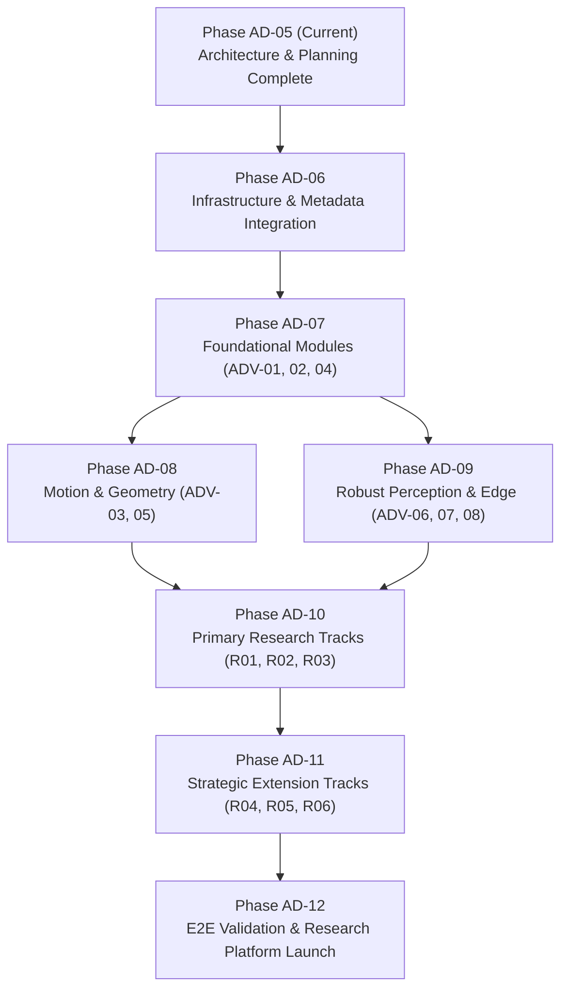

# FUTURE DEVELOPMENT PHASE PLAN (PHASES AD-06 THROUGH AD-12)
## Phased Implementation Roadmap for Advanced Modules & Research Tracks
**Document Version:** 1.0.0  
**Phase:** AD-05 Architecture Planning  
**Precondition:** Core Curriculum (Chapters 01–60) 100% Completed, Verified & Frozen

---

## 1. Roadmap Architecture & Execution Phasing

Following the architectural blueprints formulated in Phase AD-05, the implementation of the **Advanced Curriculum (ADV-01 – ADV-08)** and **Research Tracks (R01 – R06)** is phased across seven distinct execution cycles (Phases AD-06 through AD-12).

Each phase operates under strict **Zero-Regression Safeguards**: the existing 60 Core chapters, 53 unit tests, and 120 media assets must remain operational and unaffected.

---

## 2. Phase-by-Phase Implementation Specifications

### Phase AD-06: Web Infrastructure, Navigation & Metadata Integration
- **Objective:** Establish the static web infrastructure, schemas, routing, and portal views for the Advanced and Research layers without altering Core Chapter components.
- **Key Deliverables:**
  1. Creation of data stores: `src/data/advanced-modules.json` and `src/data/research-tracks.json`.
  2. Integration of new top-level navigation routes in `src/App.tsx`: `/advanced` (Advanced Curriculum Portal) and `/research` (Research Tracks Portal).
  3. Interactive DAG visualizer component displaying prerequisites and learning trajectories.
  4. Type definitions in `src/types/advancedCurriculum.ts` and `src/types/researchTracks.ts`.
- **Acceptance Criteria:**
  - `npm test`: 53 existing tests pass without regression.
  - `npm run typecheck`: 0 TypeScript errors.
  - Navigation between Core, Advanced, and Research pages is seamless and responsive.

---

### Phase AD-07: Foundational Advanced Learning Modules (ADV-01, ADV-03, ADV-06)
> *Note: Implementation sequence adjusted by project owner authorization in Phase AD-07 prompt to prioritize Intelligent Computer Vision (ADV-01, ADV-03) and Robust Visual Perception (ADV-06).*
- **Objective:** Author comprehensive graduate-level lessons, mathematical derivations, Tier A interactive labs, and computational notebooks for ADV-01, ADV-03, and ADV-06.
- **Target Modules:**
  - **ADV-01:** Mathematical Foundations for Advanced Computer Vision.
  - **ADV-03:** Robust Visual Tracking & Multi-Object Tracking Systems.
  - **ADV-06:** Robust Visual Perception in Adverse Conditions.
- **Key Deliverables:**
  - 3 comprehensive lesson documents (`index.md`) with complete LaTeX formulas.
  - 3 interactive React/Canvas Tier A playgrounds (SVD & Optimization Explorer, Synthetic MOT Arena, Adverse Conditions Explorer).
  - 3 standalone dual-engine Jupyter notebooks with Google Colab execution support.
- **Acceptance Criteria:**
  - All notebooks execute cleanly in CPU fallback and GPU environments.
  - Mathematical equations render properly with KaTeX.

---

### Phase AD-08: Advanced DIP & Spatial Geometry Modules (ADV-02, ADV-05)
- **Objective:** Deepen algorithmic image inverse problems, variational deblurring, and multi-view projective geometry.
- **Target Modules:**
  - **ADV-02:** Advanced Digital Image Processing & Mathematical Inverse Problems.
  - **ADV-05:** Multi-View Geometry & 3D Computer Vision.
- **Key Deliverables:**
  - 2 comprehensive lesson documents.
  - 2 Tier A interactive playgrounds: Variational Inverse Problem Lab and 3D Epipolar Geometry Visualizer.
  - 2 computational notebooks reproducing ADMM/ROF deconvolution and 8-point / essential matrix bundle adjustment.
- **Acceptance Criteria:**
  - Total Variation deblurring solves via ADMM.
  - Epipolar lines accurately track interactive 3D point translations.

---

### Phase AD-09: Deep Recognition, Foundation Models & Edge AI (ADV-04, ADV-07, ADV-08)
- **Objective:** Complete the remaining Advanced Curriculum modules targeting transformer detection, vision foundation models, and embedded edge deployment.
- **Target Modules:**
  - **ADV-04:** Advanced Deep Visual Recognition & Attention Mechanisms.
  - **ADV-07:** Vision Foundation Models & Parameter-Efficient Adaptation.
  - **ADV-08:** Efficient Computer Vision & Edge AI Architecture.
- **Objective:** Complete the remaining Advanced Curriculum modules targeting real-world adverse robustness, foundation models, and embedded edge deployment.
- **Target Modules:**
  - **ADV-06:** Robust Visual Perception in Adverse Conditions.
  - **ADV-07:** Vision Foundation Models & Parameter-Efficient Adaptation.
  - **ADV-08:** Efficient Computer Vision & Edge AI Architecture.
- **Key Deliverables:**
  - 3 comprehensive lesson documents.
  - 3 Tier A playgrounds: Atmospheric Haze/Rain Simulator, CLIP Zero-Shot Embedding Space Explorer, and Neural Quantization & Roofline Analyzer.
  - 3 computational notebooks covering Dark Channel Prior / Zero-DCE, LoRA fine-tuning, and PyTorch INT8 Post-Training Quantization with ONNX export.
- **Acceptance Criteria:**
  - Zero-DCE notebook achieves PSNR $> 20$ dB on sample low-light benchmarks.
  - Quantization notebook demonstrates $\ge 3\times$ size reduction with $< 1.5\%$ metric degradation.

---

### Phase AD-10: Primary Research Tracks Implementation (R01, R02, R03)
- **Objective:** Implement the research frameworks, baseline benchmarks, ablation protocols, and failure analysis pipelines for the primary academic pillars.
- **Target Tracks:**
  - **Track R01:** Intelligent Visual Detection & Recognition (MS COCO).
  - **Track R02:** Robust Multi-Object Tracking & Motion Perception (MOT17/20).
  - **Track R03:** Robust Visual Perception in Adverse Environments (Tropical Adverse Benchmark).
- **Key Deliverables:**
  - Research track guidebooks with formal problem statements and hypothesis formulation.
  - Standardized benchmark ingestion scripts and Colab execution templates.
  - Pre-computed ablation matrices and interactive Tier B telemetry dashboards.
- **Acceptance Criteria:**
  - Reproducibility checklist fully completed for all three baselines.
  - Multi-seed ($N=3$) statistical uncertainty reporting verified.

---

### Phase AD-11: Strategic Extension Research Tracks (R04, R05, R06)
- **Objective:** Implement research pipelines for Multimodal Vision-Language, Edge AI Systems, and Spatial 3D Intelligence.
- **Target Tracks:**
  - **Track R04:** Vision-Centric Multimodal Perception.
  - **Track R05:** Efficient Computer Vision & Edge AI Systems.
  - **Track R06:** Spatial Intelligence & 3D Vision.
- **Key Deliverables:**
  - 3 research track guidebooks with ablation templates.
  - Open-vocabulary grounding, edge hardware profiling, and monocular depth evaluation notebooks.
  - Interactive Tier B telemetry dashboards.
- **Acceptance Criteria:**
  - Edge AI track generates valid Pareto frontier plots (mAP vs. FPS vs. Joules).
  - 3D vision track demonstrates trajectory error calculation conforming to standard benchmarks.

---

### Phase AD-12: Full Platform Integration, Academic Audit & Release
- **Objective:** Comprehensive end-to-end audit, multi-browser testing, accessibility verification, and official release of the Advanced & Research layers.
- **Key Deliverables:**
  - Automated test suite covering new data stores and component renders.
  - Verification of all 8 advanced notebooks on Google Colab GPU runtimes.
  - Full academic documentation and publication of the complete platform artifact.
- **Acceptance Criteria:**
  - 100% test pass rate across unit and validation suites.
  - Zero build warnings or typecheck errors.
  - Ready for academic peer review and student onboarding.

