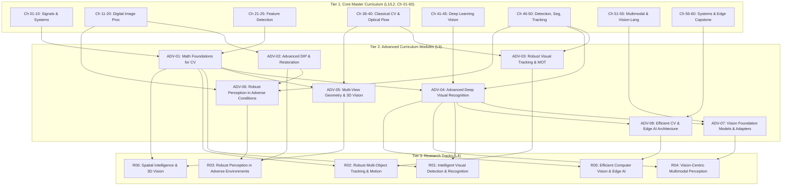

# PREREQUISITE MATRIX & DEPENDENCY GRAPH
## Multimedia & Computer Vision Learning Hub: Advanced & Research Layers
**Document Version:** 1.0.0  
**Phase:** AD-05 Architecture Planning  
**Target Architecture:** Core (L1/L2) $\rightarrow$ Advanced Modules (L3) $\rightarrow$ Research Tracks (L4)

---

## 1. Executive Summary & Graph Topology

To prevent curriculum fragmentation and cognitive overload, the learning progression across the Multimedia & Computer Vision Learning Hub is structured as a **Directed Acyclic Graph (DAG)**. 

The progression operates across three distinct tiers:
1. **Tier 1 — Core Undergraduate Curriculum (Chapters 01–60):** L1 Introductory to L2 Undergraduate Complete. Provides signal processing, digital image fundamentals, classical computer vision, basic deep learning, multimodal vision, and capstone deployment.
2. **Tier 2 — Advanced Computer Vision Modules (ADV-01 through ADV-08):** L3 Advanced Depth. Formal mathematical derivations, advanced DIP, state-of-the-art detection, robust tracking, epipolar/3D geometry, foundation vision models, and edge hardware efficiency.
3. **Tier 3 — Research Tracks (R01 through R06):** L4 Research-Ready. SOTA benchmark reproduction, novelty formulation, ablation isolation, error taxonomy, failure case analysis, and publication-standard reporting.

---

## 2. Comprehensive Dependency Matrix: Advanced Modules (ADV-01 – ADV-08)

| Module ID | Module Title | Required Core Chapters (Hard Prereq) | Recommended Core Chapters (Soft Prereq) | Required Advanced Modules | Mathematical Competencies | Programming & Toolkit Competencies |
| :--- | :--- | :--- | :--- | :--- | :--- | :--- |
| **ADV-01** | Mathematical Foundations for Advanced Computer Vision | Ch 01, 06, 11, 21, 25, 41 | Ch 02, 36, 42 | None (Entry Point to L3) | - Matrix calculus & trace derivatives - SVD & spectral decomposition - Multivariate Gaussians & Bayes rule - Karush-Kuhn-Tucker (KKT) conditions - Lie groups $\text{SO}(3), \text{SE}(3)$ | - NumPy vectorized matrix operations - SciPy scientific optimization (`scipy.optimize`) - PyTorch autograd engine internals |
| **ADV-02** | Advanced DIP & Mathematical Inverse Problems | Ch 11, 12, 13, 14, 15, 17 | Ch 16, 18, 19 | None | - 2D Continuous & Discrete Fourier Transform - Variational calculus ($L_1, L_2$ norms) - Total Variation regularization - Tikhonov regularized least-squares - Split Bregman & ADMM optimization | - NumPy 2D FFT / IFFT (`np.fft`) - SciPy sparse linear solvers - OpenCV frequency domain filtering |
| **ADV-03** | Robust Visual Tracking & MOT Systems | Ch 21, 23, 36, 37, 40, 50 | Ch 38, 48, 59 | ADV-01 (Recommended) | - State-space modeling & Kalman filters - Extended & Unscented Kalman Filtering - Bipartite matching & Hungarian Algorithm - Cosine distance & Metric Learning loss | - OpenCV optical flow (`cv2.calcOpticalFlowPyrLK`) - Scipy linear sum assignment (`scipy.optimize.linear_sum_assignment`) - PyTorch feature extraction |
| **ADV-04** | Advanced Deep Visual Recognition & Attention | Ch 41, 42, 43, 44, 45, 46, 48 | Ch 47, 49, 58 | ADV-01 (Hard) | - Scaled dot-product attention algebra - Softmax Jacobian & gradient dynamics - Multi-scale feature pyramiding (FPN) - Focal Loss & IoU/GIoU/DIoU loss formulations | - PyTorch module subclassing & custom autograd - Torchvision vision backbones - PyTorch Lightning training loops |
| **ADV-05** | Multi-View Geometry & 3D Computer Vision | Ch 01, 11, 21, 22, 25, 36 | Ch 39, 40 | ADV-01 (Hard) | - Projective geometry $\mathbb{P}^2, \mathbb{P}^3$ - Fundamental ($F$) and Essential ($E$) matrices - 8-point algorithm & Sampson error - Bundle Adjustment Levenberg-Marquardt | - NumPy homogeneous coordinate operations - OpenCV calibration & epipolar modules (`cv2.findFundamentalMat`, `cv2.recoverPose`) - Open3D / Trimesh point cloud handling |
| **ADV-06** | Robust Visual Perception in Adverse Conditions | Ch 11, 13, 15, 41, 43, 46 | Ch 17, 48, 55 | ADV-02, ADV-04 | - Radiative transfer equations (Koschmieder atmospheric model) - Illumination-reflectance retinex theory - Expected Calibration Error (ECE) - Out-of-Distribution (OOD) Mahalanobis distance | - PyTorch Albumentations corruption transforms - PyTorch calibration libraries (temperature scaling) - OpenCV dark channel prior & CLAHE |
| **ADV-07** | Vision Foundation Models & Parameter-Efficient Adaptation | Ch 44, 45, 51, 52, 53, 54 | Ch 55, 58 | ADV-04 (Hard) | - Contrastive InfoNCE loss derivation - Low-Rank matrix factorization ($W = W_0 + B A$) - Prefix tuning & cross-attention formulation - High-dimensional cosine retrieval spaces | - HuggingFace Transformers & OpenCLIP - PEFT (Parameter-Efficient Fine-Tuning) library - PyTorch mixed-precision (`torch.amp`) |
| **ADV-08** | Efficient Computer Vision & Edge AI Architecture | Ch 41, 43, 45, 56, 57, 58, 59 | Ch 50, 60 | ADV-04 (Recommended) | - Uniform vs Non-uniform affine quantization ($q = \text{round}(x/S) + Z$) - Structured vs Unstructured sparsity ($L_0, L_1$ norms) - Knowledge Distillation Kullback-Leibler divergence - Arithmetic intensity & Roofline analysis ($\text{FLOPs/Byte}$) | - PyTorch Post-Training Quantization (PTQ) & QAT - ONNX export & runtime (`onnxruntime`) - TensorRT / OpenVINO / WebGPU fundamentals |

---

## 3. Comprehensive Dependency Matrix: Research Tracks (R01 – R06)

| Track ID | Track Name | Research Focus | Primary Advanced Prereqs | Mandatory Core Prereqs | Mathematical & Statistical Benchmarks |
| :--- | :--- | :--- | :--- | :--- | :--- |
| **R01** | Intelligent Visual Detection & Recognition | High-accuracy, small-object, and multi-scale visual detection under complex scenes | ADV-01, ADV-04 | Ch 41, 42, 44, 46, 48 | - Precision-Recall AUC & COCO mAP@[.50:.95] - Hypothesis testing ($t$-test, Wilcoxon signed-rank) - Bootstrap confidence intervals ($\alpha=0.05$) |
| **R02** | Robust Multi-Object Tracking & Motion Perception | Association stability, occlusions, and camera-motion compensation in crowded scenarios | ADV-01, ADV-03 | Ch 36, 37, 40, 46, 50 | - HOTA (Higher Order Tracking Accuracy) - MOTA / MOTP & IDF1 Association Accuracy - Identity switches (IDSW) & fragmentation rate |
| **R03** | Robust Visual Perception in Adverse Environments | Tropical rain, heavy haze, lens droplets, night glares, and underwater imaging | ADV-01, ADV-02, ADV-06 | Ch 11, 13, 15, 17, 43, 46 | - Mean Corruption Error (mCE) across 15 corruptions - Expected Calibration Error (ECE) & Brier Score - PSNR / SSIM / LPIPS under physical atmospheric noise |
| **R04** | Vision-Centric Multimodal Perception | Grounded visual reasoning, zero-shot open-vocabulary detection, and vision-audio alignment | ADV-04, ADV-07 | Ch 44, 51, 52, 53, 54, 55 | - Zero-shot Top-1/Top-5 accuracy - Recall@K for image-text and text-image retrieval - Grounding Recall & Pointing Game accuracy |
| **R05** | Efficient Computer Vision & Edge AI Systems | Ultra-low latency, memory-constrained neural execution on heterogeneous edge devices | ADV-04, ADV-08 | Ch 43, 56, 57, 58, 59, 60 | - Pareto frontier (mAP vs FPS vs Model Size in MB) - Energy per inference (Joules/frame) - Worst-case P99 latency & memory bandwidth bounds |
| **R06** | Spatial Intelligence & 3D Vision | Monocular depth, visual odometry, neural radiance representations, and 3D bounding boxes | ADV-01, ADV-05 | Ch 21, 22, 25, 36, 40, 50 | - Absolute relative error (AbsRel) & RMSE in meters - Threshold accuracy $\delta < 1.25, 1.25^2, 1.25^3$ - Absolute Trajectory Error (ATE) & Relative Pose Error (RPE) |

---

## 4. Academic Track Prerequisites & Flow Paths

Learners can follow distinct academic trajectories based on their intended research or career specialization:

### Path A: Intelligent Detection & Recognition Specialist (Pillar 1)
$$\text{Core (Ch 41–48)} \longrightarrow \text{ADV-01} \longrightarrow \text{ADV-04} \longrightarrow \mathbf{R01}$$

### Path B: Autonomous Visual Tracking & Surveillance Specialist (Pillar 1 & 2)
$$\text{Core (Ch 36–40, 46–50)} \longrightarrow \text{ADV-01} \longrightarrow \text{ADV-03} \longrightarrow \mathbf{R02}$$

### Path C: Adverse Environment & Tropical Robustness Researcher (Pillar 2 — ITERA Priority)
$$\text{Core (Ch 11–17, 41–46)} \longrightarrow \text{ADV-02} \longrightarrow \text{ADV-06} \longrightarrow \mathbf{R03}$$

### Path D: Vision-Language & Multimodal Perception Specialist (Pillar 3)
$$\text{Core (Ch 44–45, 51–55)} \longrightarrow \text{ADV-04} \longrightarrow \text{ADV-07} \longrightarrow \mathbf{R04}$$

### Path E: Edge AI & Embedded Vision Systems Engineer (Pillar 4)
$$\text{Core (Ch 41–45, 56–60)} \longrightarrow \text{ADV-04} \longrightarrow \text{ADV-08} \longrightarrow \mathbf{R05}$$

### Path F: Spatial AI & Multi-View Geometry Researcher (Spatial Intelligence)
$$\text{Core (Ch 21–25, 36–40)} \longrightarrow \text{ADV-01} \longrightarrow \text{ADV-05} \longrightarrow \mathbf{R06}$$

---

## 5. Formal Proof of Acyclicity (No Circular Dependencies)

To guarantee that the curriculum graph is a valid DAG ($\mathcal{G} = (\mathcal{V}, \mathcal{E})$ where $\mathcal{V}$ are curriculum nodes and $\mathcal{E}$ are directed dependency edges):

1. **Topological Order Definition:**
   Assign a topological level function $\tau : \mathcal{V} \rightarrow \mathbb{N}$:
   - Tier 1 (Core Chapters $01 \le c \le 60$): $\tau(c) = c$ (with internal order $c_i \rightarrow c_j \iff i < j$).
   - Tier 2 (Advanced Modules ADV-$k$): $\tau(\text{ADV-01}) = 101$, $\tau(\text{ADV-02}) = 102$, $\tau(\text{ADV-03}) = 103$, $\tau(\text{ADV-04}) = 104$, $\tau(\text{ADV-05}) = 105$, $\tau(\text{ADV-06}) = 106$, $\tau(\text{ADV-07}) = 107$, $\tau(\text{ADV-08}) = 108$.
   - Tier 3 (Research Tracks R-$m$): $\tau(\text{R01}) = 201, \dots, \tau(\text{R06}) = 206$.

2. **Edge Validity Condition:**
   For every directed dependency edge $(u, v) \in \mathcal{E}$ stating "$u$ is a prerequisite for $v$":
   $$\tau(u) < \tau(v)$$

3. **Inspection of Cross-Module Edges:**
   - $\text{ADV-01} \rightarrow \text{ADV-04}$: $\tau(\text{ADV-01}) = 101 < 104 = \tau(\text{ADV-04})$.
   - $\text{ADV-01} \rightarrow \text{ADV-05}$: $\tau(\text{ADV-01}) = 101 < 105 = \tau(\text{ADV-05})$.
   - $\text{ADV-02} \rightarrow \text{ADV-06}$: $\tau(\text{ADV-02}) = 102 < 106 = \tau(\text{ADV-06})$.
   - $\text{ADV-04} \rightarrow \text{ADV-07}$: $\tau(\text{ADV-04}) = 104 < 107 = \tau(\text{ADV-07})$.
   - $\text{ADV-04} \rightarrow \text{ADV-08}$: $\tau(\text{ADV-04}) = 104 < 108 = \tau(\text{ADV-08})$.
   - All Advanced to Research edges satisfy $\tau(\text{ADV-}k) \le 108 < 201 \le \tau(\text{R-}m)$.
   - There are **no back-edges** from Tier 3 to Tier 2 or Tier 1 ($\forall (u, v) \in \mathcal{E}, \text{Tier}(u) \le \text{Tier}(v)$).
   - Within Tier 2, all prerequisites flow strictly from lower index to higher index with no bidirectional coupling.

**Conclusion:** The dependency structure is strictly monotonic and **guaranteed acyclic**, ensuring students and researchers never encounter circular prerequisites.

