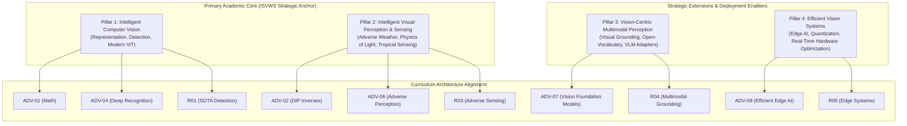
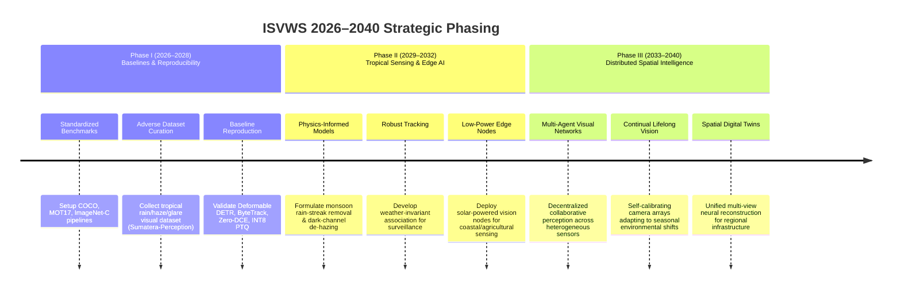

# STRATEGIC RESEARCH ROADMAP ALIGNMENT (ISVWS 2026–2040)
## Positioning the Multimedia & Computer Vision Learning Hub within Intelligent Visual Perception & Sensing
**Document Version:** 1.0.0  
**Phase:** AD-05 Architecture Planning  
**Target Roadmap:** ISVWS 2026–2040 (Intelligent Sensing & Vision Works / Systems)  
**Academic Institution:** Institut Teknologi Sumatera (ITERA)  
**Primary Discipline:** S1 Teknik Telekomunikasi / Intelligent Computer Vision

---

## 1. Vision & Institutional Strategic Alignment

The **Multimedia & Computer Vision Learning Hub** is engineered not merely as a passive undergraduate teaching repository, but as the foundational intellectual launchpad for long-term scientific research under the **ISVWS 2026–2040 Roadmap** (*Intelligent Sensing & Vision Works / Systems*).

### Academic Identity & Hierarchy
- **Primary Expertise (Pillar 1):** **Intelligent Computer Vision** — Deep geometric and semantic visual representation learning, modern neural perception, and spatial reasoning.
- **Research Focus (Pillar 2):** **Intelligent Visual Perception & Sensing** — Physical sensor modeling, visual robustness in adverse environments (tropical rain, extreme solar glare, heavy haze, coastal maritime haze), and physical-layer degradation recovery.
- **Strategic Extensions (Pillars 3 & 4):**
  - **Pillar 3: Vision-Centric Multimodal Perception** — Vision-language grounding, audio-visual synchrony, and parameter-efficient visual adaptation.
  - **Pillar 4: Efficient Vision Systems & Edge AI** — Low-latency, energy-efficient vision pipelines deployed on constrained edge processors for distributed monitoring.

---

## 2. Four Pillars Detailed Breakdown

### Pillar 1: Intelligent Computer Vision (Academic Foundation)
- **Scientific Thrust:** Moving beyond classical heuristic feature engineering toward mathematically principled visual representations. Focuses on deformable attention, multi-scale feature aggregation, continuous bounding box uncertainty modeling, and state-of-the-art vision transformers.
- **Curricular Anchors:** Core Ch 41–48 $\rightarrow$ ADV-01, ADV-04 $\rightarrow$ Track R01.
- **Target Venues:** IEEE CVPR, ICCV, ECCV, IEEE Transactions on Pattern Analysis and Machine Intelligence (TPAMI).

### Pillar 2: Intelligent Visual Perception & Sensing (Regional & Physical Focus)
- **Scientific Thrust:** Visual sensing in the wild is severely degraded by physical atmospheric phenomena. In tropical regions (such as Sumatera, Indonesia), monsoons, high humidity, solar flares, peatland haze, and ocean sea-spray induce complex non-linear scattering and attenuation. This pillar investigates physics-informed atmospheric transfer models, zero-reference low-light enhancement, and safety-critical Out-of-Distribution (OOD) calibration.
- **Curricular Anchors:** Core Ch 11–17, 43, 46 $\rightarrow$ ADV-02, ADV-06 $\rightarrow$ Track R03.
- **Target Venues:** IEEE Transactions on Image Processing (TIP), IEEE Sensors Journal, WACV, CVPR Workshop on Vision in Adverse Conditions.

### Pillar 3: Vision-Centric Multimodal Perception (Semantic Horizon)
- **Scientific Thrust:** Enriching visual representations with grounded auxiliary modalities while maintaining visual perception as the primary anchor. Covers open-vocabulary detection, parameter-efficient fine-tuning (LoRA / prefix tuning) of vision backbones, and spatial-audio-visual tracking.
- **Curricular Anchors:** Core Ch 44, 51–55 $\rightarrow$ ADV-07 $\rightarrow$ Track R04.
- **Target Venues:** NeurIPS, ACM Multimedia, EMNLP (Multimodal track), IROS.

### Pillar 4: Efficient Vision Systems & Edge AI (Real-World Deployment)
- **Scientific Thrust:** High-capacity vision models cannot run on energy-constrained embedded nodes without severe quantization and latency penalties. This pillar addresses hardware-aware neural architecture search, integer-only matrix quantization (INT8/INT4), structured tensor pruning, and heterogeneous acceleration (NPU/GPU/CPU).
- **Curricular Anchors:** Core Ch 56–60 $\rightarrow$ ADV-08 $\rightarrow$ Track R05.
- **Target Venues:** IEEE Transactions on Circuits and Systems for Video Technology (TCSVT), TinyML, Embedded Systems Week (ESWEEK).

---

## 3. Fifteen-Year Phased Milestones (2026–2040)

The research development path spans three strategic five-year tranches aligned with national research priorities and academic faculty maturation:

### Phase I: Foundation, Reproducibility & Benchmark Mastery (2026–2028)
1. **Academic Objectives:**
   - Establish 100% reproducible SOTA baseline implementations across object detection, MOT, image restoration, and edge quantization.
   - Collect and publish the first iteration of the **Sumatera Tropical Vision Benchmark (STVB)**: a standardized, open-access adverse condition dataset capturing tropical storms, peatland haze, high-humidity glare, and low-light plantation environments.
2. **Curriculum Outcomes:**
   - Full publication of Advanced Modules ADV-01 through ADV-04.
   - First cohort of undergraduate capstones graduating with papers submitted to national SINTA-indexed journals and regional IEEE conferences (e.g. IEEE Cybernetics & Intelligent Systems, TENCON).

### Phase II: Robust Adaptation & Edge Intelligence (2029–2032)
1. **Academic Objectives:**
   - Develop novel physics-guided deep restoration networks coupling radiative transfer physics with neural attention.
   - Design lightweight, sub-5W embedded vision algorithms for off-grid environmental monitoring (illegal deforestation detection, wildlife tracking, coastal tsunami wave observation).
2. **Curriculum Outcomes:**
   - Activation of Research Tracks R01, R02, R03, and R05.
   - Transition of top graduates to prestigious international PhD programs with high-impact publications (Q1 journals, CORE A/A* conferences).

### Phase III: Distributed Spatial Intelligence & Lifelong Vision (2033–2040)
1. **Academic Objectives:**
   - Pioneer self-supervised, lifelong learning vision arrays capable of autonomous continual learning without catastrophic forgetting under year-round weather shifts.
   - Large-scale multi-camera distributed 3D spatial intelligence for smart city corridors and critical transportation infrastructure in Western Indonesia.
2. **Curriculum Outcomes:**
   - Advanced Modules ADV-05, ADV-06, ADV-07, and ADV-08 mature into fully established graduate seminar courses.
   - International research collaborations and funded grants (LPDP, BRIN, bilateral international partnerships).

---

## 4. Regional Impact & Thematic Application Scenarios

The research tracks are grounded in tangible Indonesian and Southeast Asian challenges:
1. **Sumatera Maritime & Coastal Monitoring:** Autonomous vessel detection, wave-height estimation, and port safety tracking under dense marine sea-spray and night fog (Tracks R01, R02, R03).
2. **Agricultural & Tropical Plantation Analytics:** Oil palm / rubber yield estimation, automated drone canopy segmentation, and pest detection under intense solar reflectance and canopy shadow occlusions (Tracks R01, R04, R05).
3. **Smart Regional Transportation Corridors:** Multi-object vehicle tracking and license plate recognition under torrential monsoon rain downpours on the Trans-Sumatera Highway (Tracks R02, R03, R05).

