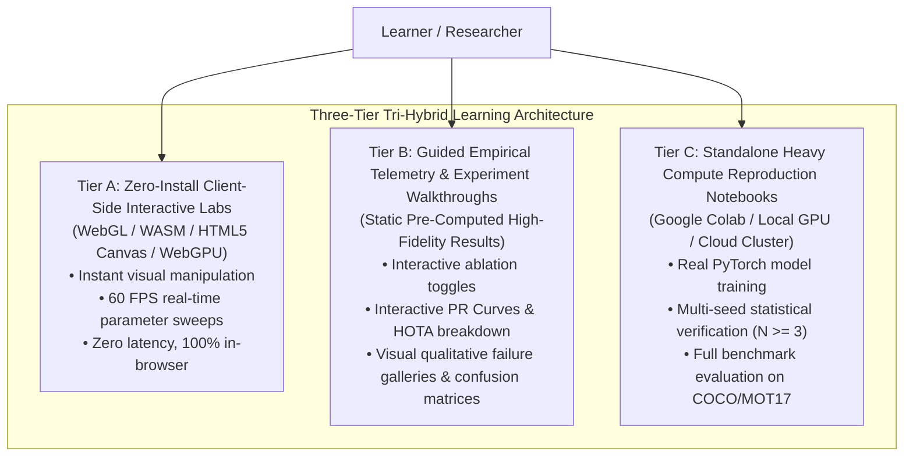

# WEB-FIRST LEARNING ARCHITECTURE & INTERACTIVE DESIGN
## Delivering Graduate-Level Computer Vision on a Static-First Web Platform
**Document Version:** 1.0.0  
**Phase:** AD-05 Architecture Planning  
**Target Deployment:** Static Web Application (GitHub Pages / Vercel / Netlify Compatible)  
**Client Stack:** React 19, TypeScript, Vite, Tailwind CSS, Lucide Icons, WebGL/WASM/WebGPU

---

## 1. Architectural Philosophy: The Static-First Imperative

The **Multimedia & Computer Vision Learning Hub** is distributed as a zero-cost, static web application. It must remain accessible to students worldwide without requiring:
- A dedicated GPU cloud backend or paid server infrastructure.
- Local high-end workstation hardware for basic learning and exploration.
- Complex local Python/CUDA driver installations just to understand modern research concepts.

To bridge the gap between high-compute Computer Vision research (which demands NVIDIA GPUs) and static web accessibility, we formulate the **Three-Tier Tri-Hybrid Learning Architecture**:



---

## 2. Three-Tier Learning Experience Specification

### 2.1 Tier A: In-Browser Real-Time Interactive Laboratories
- **Technology:** HTML5 2D Canvas, WebGL shaders, lightweight WebAssembly (OpenCV.js or ONNX Runtime Web via WASM/WebGPU).
- **Purpose:** Immediate intuitive grasp of mathematical and geometric concepts before touching deep learning code.
- **Example Deployments:**
  - *ADV-01 Lab:* Interactive 3D SVD ellipsoid visualizer and quadratic surface optimization gradient descent simulator.
  - *ADV-02 Lab:* Real-time Total Variation image deblurring and Fourier domain filter manipulation on a test image.
  - *ADV-03 Lab:* Synthetic Multi-Object Tracking arena: user drags simulated targets with occlusions; Kalman state filter and Hungarian bipartite assignment update at 60 FPS.
  - *ADV-05 Lab:* Epipolar geometry playground: two synthetic cameras with interactive 3D point movement showing epipolar line projection and essential matrix calculation in real time.

### 2.2 Tier B: Guided Empirical Telemetry & Qualitative Failure Inspector
- **Technology:** Interactive SVG/Canvas charts (Recharts / Chart.js), synchronized video/image sliders, and pre-computed JSON metric datasets.
- **Purpose:** Provide learners with the deep insights of a multi-day GPU benchmark run without executing the code themselves.
- **Features:**
  1. **Ablation Comparator:** Toggle architectural components (e.g., $+ \text{Deformable Attention}$, $+ \text{Focal Loss}$, $+ \text{Multi-Scale}$) and watch precision-recall curves, mAP, and inference latency update dynamically from pre-computed evaluation logs.
  2. **Qualitative Failure Inspector:** A curated visual gallery categorizing true positives, false positives, false negatives, and catastrophic failure modes under adverse conditions (e.g. rain streaking vs. night glare).
  3. **Statistical Confidence Intervals:** Render error bars showing $\pm 1\sigma$ variations across 5 experimental seeds for published models.

### 2.3 Tier C: Reproducible Computational Notebooks (Colab / GPU)
- **Technology:** Standalone Jupyter notebooks conforming to nbformat v4, PyTorch, PyTorch Lightning, Torchvision, Albumentations, and ONNX.
- **Purpose:** Full end-to-end training, fine-tuning, and metric calculation on official benchmark datasets.
- **Features:**
  - One-click "Open in Google Colab" badge with auto-environment setup cells.
  - Deterministic seed configuration (`torch.manual_seed(42)`).
  - Explicit execution time estimates (e.g., "~15 minutes on T4 GPU", "~4 hours for full COCO fine-tuning").
  - Dual-engine fallback: When GPU is unavailable, scripts execute on synthetic micro-tensors in CPU mode to verify logic correctness without crashing.

---

## 3. Metadata Schemas for Advanced Layers

To integrate the Advanced Curriculum and Research Tracks into the platform's data-driven UI without modifying the 60 Core chapters, two new canonical metadata schemas are specified:

### 3.1 Advanced Modules Schema (`advanced-modules.json`)
```json
{
  "$schema": "http://json-schema.org/draft-07/schema#",
  "title": "AdvancedModulesRegistry",
  "type": "array",
  "items": {
    "type": "object",
    "required": ["id", "code", "title", "level", "pillar", "prerequisites", "topics", "benchmarks", "interactiveLab"],
    "properties": {
      "id": { "type": "string", "example": "adv-01" },
      "code": { "type": "string", "example": "ADV-01" },
      "title": { "type": "string", "example": "Mathematical Foundations for Advanced Computer Vision" },
      "level": { "type": "string", "enum": ["L3 Advanced Depth", "L4 Research Ready"] },
      "pillar": { "type": "integer", "enum": [1, 2, 3, 4] },
      "prerequisites": {
        "type": "object",
        "properties": {
          "coreChapters": { "type": "array", "items": { "type": "integer" } },
          "advancedModules": { "type": "array", "items": { "type": "string" } }
        }
      },
      "estimatedHours": { "type": "integer", "example": 14 },
      "topics": {
        "type": "array",
        "items": {
          "type": "object",
          "properties": {
            "topicNumber": { "type": "integer" },
            "title": { "type": "string" },
            "mathematicalFocus": { "type": "string" }
          }
        }
      },
      "benchmarks": { "type": "array", "items": { "type": "string" } },
      "interactiveLab": {
        "type": "object",
        "properties": {
          "componentName": { "type": "string", "example": "OptimizationGeometryLab" },
          "tier": { "type": "string", "enum": ["Tier-A", "Tier-B", "Tier-C"] }
        }
      }
    }
  }
}
```

### 3.2 Research Tracks Schema (`research-tracks.json`)
```json
{
  "$schema": "http://json-schema.org/draft-07/schema#",
  "title": "ResearchTracksRegistry",
  "type": "array",
  "items": {
    "type": "object",
    "required": ["id", "code", "title", "pillar", "category", "prerequisites", "milestones", "targetVenues"],
    "properties": {
      "id": { "type": "string", "example": "r01" },
      "code": { "type": "string", "example": "R01" },
      "title": { "type": "string", "example": "Intelligent Visual Detection & Recognition" },
      "pillar": { "type": "string", "example": "Pillar 1: Intelligent Computer Vision" },
      "category": { "type": "string", "enum": ["Primary Academic Anchor", "Strategic Extension", "Optional Specialization"] },
      "prerequisites": {
        "type": "object",
        "properties": {
          "coreChapters": { "type": "array", "items": { "type": "integer" } },
          "advancedModules": { "type": "array", "items": { "type": "string" } }
        }
      },
      "primaryBenchmark": { "type": "string", "example": "MS COCO 2017 detection split" },
      "standardMetrics": { "type": "array", "items": { "type": "string" } },
      "milestones": {
        "type": "array",
        "items": {
          "type": "object",
          "properties": {
            "phase": { "type": "string" },
            "title": { "type": "string" },
            "deliverable": { "type": "string" }
          }
        }
      },
      "targetVenues": { "type": "array", "items": { "type": "string" } }
    }
  }
}
```

---

## 4. UI/UX Navigation & Architecture Integration

To preserve the completed 60-chapter experience while seamlessly surfacing the Advanced & Research layers:

```
Top Navigation Bar:
[ Logo: Multimedia & CV ]  [ Tracks ]  [ Chapters (01-60) ]  [ ★ Advanced Curriculum (NEW) ]  [ 🔬 Research Tracks (NEW) ]  [ GitHub ]
```

### Navigation Rules:
1. **Zero Regression for Core:** The existing Chapter Catalog (`/chapters`) and Track Explorer (`/tracks`) remain 100% untouched.
2. **Dedicated Advanced Portal (`/advanced`):**
   - Renders interactive DAG showing progression from Core into Modules ADV-01 through ADV-08.
   - Filterable by Research Pillar (Pillars 1–4).
   - Module detail view featuring theory derivation, interactive Tier A playground, Tier B ablation dashboard, and Colab launch links.
3. **Dedicated Research Portal (`/research`):**
   - Interactive Research Track explorer (R01–R06).
   - Common Methodology reference guide and reproducible experiment checklist.
   - Benchmark leaderboard and pre-computed experimental telemetry viewer.

